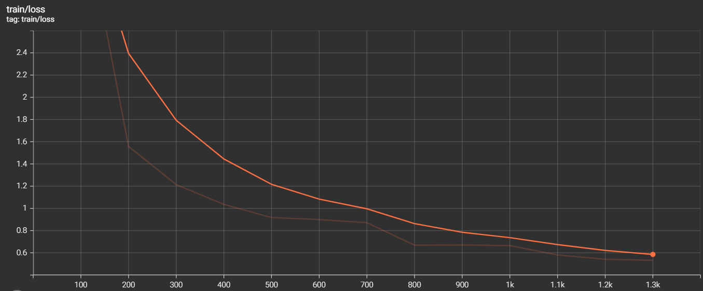

# Deliverable 2 — DISTRIBUTED: BERT-Base on SQuAD with DDP (2 nodes × 2 A100)

## Overview

This deliverable parallelizes the single-GPU implementation of Deliverable 1 (BERT-Base fine-tuning on SQuAD for extractive question answering) using PyTorch's native `DistributedDataParallel` (DDP), driven by the Hugging Face `Trainer`. The distributed version is tested on **2 nodes with 2 GPUs each (4 GPUs in total)** of the FinisTerrae III A100 partition.

**Hardware.** Each A100 node of FinisTerrae III has 2 × NVIDIA A100 (A100-PCIE-40GB: 40 GB HBM2 at 1,555 GB/s), 2 × Intel Xeon Ice Lake 8352Y (64 cores), 256 GB of RAM, a 960 GB local NVMe and an InfiniBand connection to the rest of the cluster.

**Strategy.** Only DDP was used. The model state is tiny compared with the GPU memory (detailed in *Previous step*), so sharded strategies (ZeRO, FSDP) would add communication without solving any problem.

Experiments write their results to `runs/` (git-ignored). To reproduce: `mkdir -p runs/logs && sbatch train_distributed.sh`.

## Previous step: single-GPU optimization

### Removing the padding

The baseline of Deliverable 1 padded every sample to 384 tokens. The training set has 88,524 features, but only **15,115,761 real tokens per epoch** (≈171 per feature) against 33,993,216 padded tokens, so **55.5 % of the work was padding**. Using dynamic padding (`--pad_to_max_length False`) together with `--group_by_length True` (batches of similar length) removes it. The run time went from 25 min 08 s to 12 min 06 s (**2.08×**), close to the 2.25× that removing the padding would give if cost were proportional to tokens.

### Model size and memory: why batch size 64

- Trainable parameters: **108,893,186** (`Number of trainable parameters` in the Trainer log).
- Memory independent of the batch size, with `adamw_torch` and BF16 autocast (master weights stay in FP32): 4 B (weights) + 4 B (gradients) + 8 B (Adam moments) = 16 B/parameter, i.e. **≈ 1.74 GB (1.62 GiB)**.
- Measured peak at batch size 64: **20.23 GiB allocated / 20.80 GiB reserved** (21.3 GiB seen by `nvidia-smi`) out of 39.49 GiB. Almost all of it is activations, ≈ 0.29 GiB per sample, which scale linearly with the batch size.
- With `--auto_find_batch_size` starting at 128 (halving on out-of-memory), 128 did not fit and 64 did, so 64 is the largest multiple of 64 that fits.
- Since the model state is 1.6 GiB out of 39.5 GiB, ZeRO or FSDP are not needed.

### Tokens, FLOPs and MFU

FLOPs follow the rule `6 · N · D` (N = 108,893,186 parameters, D = tokens, 4 epochs). Padded tokens: 4 × 88,524 × 384 = 135,972,864. Real tokens: 4 × 15,115,761 = **60,463,044**.

- FLOPs including padding: 6 · N · 135,972,864 = **8.88·10¹⁶**
- Useful FLOPs (real tokens): 6 · N · 60,463,044 = **3.95·10¹⁶**

| Version | Runtime | samples/s | TFLOP/s (padded tokens) | MFU (padded) | TFLOP/s (useful) | MFU (useful) |
|---|---|---|---|---|---|---|
| Deliverable 1 baseline (padding to 384) | 1508.03 s (25:08) | 234.8 | 58.9 | 18.9 % | 26.2 | **8.4 %** |
| No padding (`group_by_length`) | 726.47 s (12:06) | 487.4 | — | — | 54.4 | **17.4 %** |

The MFU computed with padded tokens (18.9 %) looks better than the optimized one (17.4 %), but part of that computation was useless. Counting only real tokens, the useful MFU doubles from 8.4 % to 17.4 %, which is where the 2× speed-up comes from. For the optimized run the executed tokens are the real tokens plus a small amount of dynamic padding inside each batch, which was not measured, so useful and executed FLOPs are taken as equal. `nvidia-smi` showed 94–100 % utilization in the baseline, which does not mean a high MFU: utilization only says that some kernel was running.

### Model quality

| Run | train loss | Exact Match | F1 |
|---|---|---|---|
| Deliverable 1 baseline | 0.8732 | 80.07 | 87.73 |
| 1 GPU, no padding | 0.8691 | 79.70 | 87.62 |

The training loss is practically the same (slightly worse), but removing the padding is a massive improvement with no significant impact on the result.

## Distributed version: 2 nodes × 2 A100 (4 GPUs)

### Setup

- SLURM: `--nodes=2 --ntasks-per-node=1 --gres=gpu:a100:2`. `srun` starts `launch_node.sh` on each node, which runs `torchrun --nnodes=$SLURM_NNODES --nproc_per_node=2 --node_rank=$SLURM_NODEID --master_addr=$MASTER_ADDR ...`. The Trainer detects the `torchrun` environment and enables DDP by itself (DDP model wrapper, distributed sampler, gradient all-reduce in `backward()`).
- A static rendezvous with an explicit `node_rank` is used because the default `c10d` rendezvous failed: the SLURM node names (`a100-NN`) are not the machines' real hostnames, so no node recognised itself as the server.
- Dataset caching: with two nodes, both would build the same cache file concurrently on the shared file system and crash (SIGBUS). Hence `main_process_first(local=False)` in `run_qa.py`.
- Hyper-parameters are those of the 1 GPU run (batch 64 per GPU, 4 epochs, BF16 + TF32, `adamw_torch`, 8 DataLoader workers per process, sequence length 384, dynamic padding, `group_by_length`) except for the ones the larger batch requires: the **global batch is 256** (64 × 4 GPUs), so there are 1,384 optimizer steps instead of 5,536. The learning rate was raised from 3e-5 to **6e-5** (square-root scaling was used) with a **10 % linear warm-up** (139 steps).
- The 1 GPU runs requested 32 CPUs per task and the 4 GPU run 64 (whole nodes); both use 8 DataLoader workers per process.

### Results

| Metric | Value |
|---|---|
| Runtime (`train_runtime`) | 245.19 s (4:05) |
| Throughput | 1,444.1 samples/s (5.645 steps/s) |
| Total / per-GPU TFLOP/s (useful) | 161.1 / 40.3 |
| MFU per GPU (useful, vs 312 TFLOP/s peak on bf16 with tensor cores) | **12.9 %** |
| Peak memory per GPU (rank 0) | 20.65 GiB allocated / 21.10 GiB reserved |
| Exact Match / F1 | 79.98 / 87.63 |
| `train_loss` | 1.0397 |

FLOPs are the same as in the sequential run (3.95·10¹⁶); TFLOP/s = 3.95·10¹⁶ / 245.19 s = 161.1 TFLOP/s in total, i.e. 40.3 per GPU.

The evaluation metrics are the valid quality check and are the same as in the sequential run. The training loss curve is in `images/loss.png`.

### Comparison with the sequential version

| Configuration | GPUs | Runtime | samples/s | samples/s per GPU | Speed-up | Efficiency | MFU per GPU | EM / F1 |
|---|---|---|---|---|---|---|---|---|
| 1 GPU, no padding | 1 | 726.5 s | 487.4 | 487.4 | 1.00× | 100 % | 17.4 % | 79.70 / 87.62 |
| DDP, 2 nodes × 2 GPUs | 4 | 245.2 s | 1,444.1 | 361.0 | **2.96×** | **74 %** | 12.9 % | 79.98 / 87.63 |

Scaling efficiency is `speed-up / number of GPUs` = 2.96 / 4 ≈ **74 % (≈ 75 %)**. With respect to the Deliverable 1 baseline, the two improvements together (no padding × DDP) make the training **6.15×** faster (1508 s → 245 s).

Where the remaining 26 % goes: a step takes 131 ms on 1 GPU (726.5 s / 5,536 steps) and 177 ms on 4 GPUs (245.2 s / 1,384 steps), i.e. ≈ 46 ms more per step. The gradients are 108.9 M × 4 B = 436 MB, and a ring all-reduce moves `2(N−1)/N` of that (≈ 0.65 GB) per GPU and step. At the bandwidth of one HDR-100 link (≈ 12.5 GB/s) that is ≈ 50 ms, consistent with the extra time. The remaining overhead may also come from load imbalance between ranks, because `group_by_length` gives each rank batches of different lengths and every step waits for the slowest one.

## Profiling

Short runs (30 steps) with `PROFILE=1` were profiled with `torch.profiler` and visualised in TensorBoard. They are only used to read proportions, not times: the profiler adds overhead and `group_by_length` puts the longest batches first.

| | 1 GPU | 4 GPUs (DDP) |
|---|---|---|
| Kernels (GPU busy) | 78.5 % | 75.5 % |
| CPU execution without kernels | 14.8 % | 17.3 % |
| Other | 6.7 % | 7.1 % |
| Memcpy / DataLoader | ~0 % | ~0 % |
| Time of GPU kernels on Tensor Cores | 33 % | 20 % |

- Neither the input pipeline nor the host–device copies are a bottleneck, and the kernels `ampere_bf16_s16816gemm` confirm that BF16 GEMMs run on Tensor Cores.
- In the single-GPU profile, about half of the GPU time is elementwise kernels (GELU, LayerNorm, dropout, optimizer updates), which are memory-bound; together with the GEMMs running at a fraction of the peak, this explains the moderate MFU.
- **In the distributed profile, `ncclKernel_AllReduce_Ring` is the most time-consuming kernel, with 56.6 % of the kernel time shown** in the kernel view, far above any GEMM (≈ 8 % or less each). This number is high but it does not mean that communication takes 56 % of a step: the all-reduce runs on a separate stream and overlaps with the backward pass, the pie adds up kernel durations, and the duration of a NCCL kernel includes the time it waits for the other ranks (it keeps the GPU busy while waiting for data or for slower ranks). For the same reason the 75 % "GPU utilization" includes this kernel and is not useful compute, and the Tensor Cores share falls from 33 % to 20 %: the all-reduce adds kernel time that does not use them.